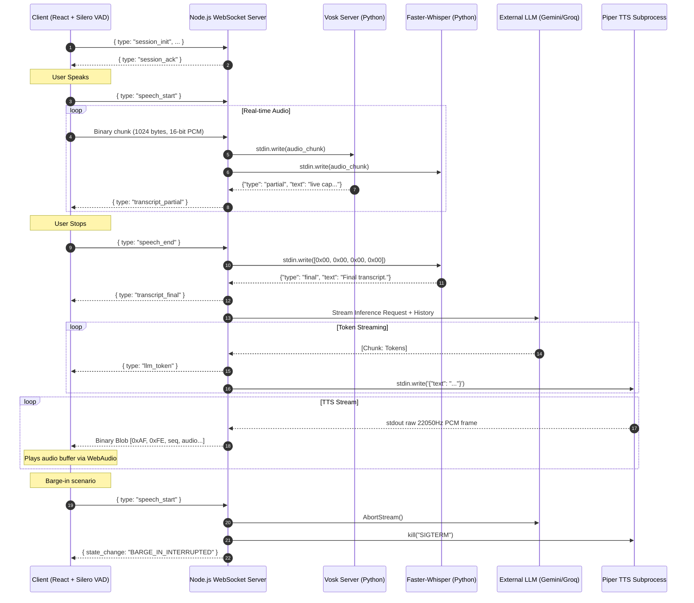

# Vani - Voice-Based AI Agent
## Master Technical Specification and Product Requirements Document (PRD)

---

# 1. Executive Summary & Core Architecture

**Overview:**
Vani is an ultra-low latency, persistent voice-based AI agent designed to interact with users over a continuous audio stream. It operates via a real-time WebSocket architecture rather than traditional HTTP Request/Response or WebRTC patterns. The system relies heavily on local, highly-optimized processes (Faster-Whisper for high-quality final transcriptions, Vosk for low-latency live captions, and Piper for low-latency text-to-speech) mapped alongside streaming cloud LLM invocations (Gemini and Groq) to deliver sub-second conversational latency.

**End-to-End Voice Pipeline:**
1. **Mic Capture:** The React/Vite client captures user audio (16kHz mono) applying native echo cancellation, noise suppression, and auto gain control.
2. **Voice Activity Detection (VAD):** A client-side Silero ONNX model continually analyzes frames, filtering noise. On detecting speech \`speech_start\` is fired over the WebSocket.
3. **Audio Streaming:** Raw 16-bit Float32 PCM is converted to Int16 PCM and streamed in 512-sample (32ms) chunks over WebSockets to the Node.js server.
4. **Speech-to-Text (STT):**
   - The server pushes the PCM to a persistent Python **Faster-Whisper** subprocess handling final generation.
   - Synchronously, the server routes PCM to an independent **Vosk** subprocess pushing live, interim captions to the client.
5. **Session Orchestration:** Upon user silence, \`speech_end\` finalizes the transcription buffer. Nodes state machine manages the jump from STT to LLM.
6. **LLM Inference:** The text is dispatched to Gemini (or Groq) using chunked, token-by-token streaming. The system drops "thinking" buffers (removing \`<think>\` tags).
7. **Text-to-Speech (TTS):** Sanitized text buffers stream instantly into a local **Piper TTS** subprocess. Piper streams 22050Hz raw PCM chunks directly to the active WebSocket.
8. **Client Audio Playback:** The client decodes binary chunks against a custom framing header (\`0xAF 0xFE\`) and schedules playback through the browser Web Audio API context.

**Architecture Diagram:**

---

# 2. Technology Stack & Dependency Matrix

| Category | Technology / Package | Exact Version | Specific Role in Vani |
|---|---|---|---|
| **Backend Runtime** | Node.js (via \`ts-node\`) | ^20 (Types) / 10.9 (ts-node) | Central WebSocket orchestrator, file server, and state machine wrapper. |
| **Backend Database** | \`better-sqlite3\` | ^11.10.0 | Persistent, local disk WAL-mode database for session history and summarization. |
| **Backend Comm** | \`ws\` | ^8.18.0 | Standard WebSockets for binary and JSON payload transportation. |
| **Frontend Framework**| React + ReactDOM / Vite | ^19.2.8 / ^6.1.0 | Client UI rendering side (History Sidebar, Orb interface, Logs). |
| **Voice Activity** | \`@ricky0123/vad-web\` | 0.0.22 | Silero VAD implementation loaded via local WASM/ONNX instances. |
| **Python Audio STT** | \`faster-whisper\` | \`==1.0.3\` | Highly accurate CPU-optimized (\`int8\`) end-of-utterance transcription. |
| **Python Live STT** | \`vosk\` | \`==0.3.45\` | Ultra-low latency partial captions mapped strictly to local models. |
| **LLM Provider (A)** | \`@google/genai\` | ^2.19.0 | Primary backend logic for Gemini, supporting dynamic tools and web grounding. |
| **LLM Provider (B)** | \`groq-sdk\` | ^1.5.0 | Alternative engine mapping LPU inference over models like \`qwen3.6-27b\`. |

**External Resources & Cloud Backends Details:**
- **Whisper & Vosk:** Operate synchronously via local Python sub-processes.
- **Piper TTS:** Accessed locally through a binary execution pattern.
- **Gemini:** Requires \`GEMINI_API_KEY\`, defaults to \`gemini-2.5-flash-lite\` model. Uses native function calling and search grounding metadata blocks.
- **Groq:** Requires \`GROQ_API_KEY\`, defaults to \`qwen/qwen3.6-27b\`.
- External tools rely natively on Gemini function callbacks using HTTP requests directed by LLM constraints.

---

# 3. Audio & Voice Engineering Parameters

**Audio Ingestion & Microphone Settings:**
- **Sample Rate:** Strictly 16,000 Hz.
- **Bit Depth:** 16-bit Float32 cast to Int16 before wire dispatch.
- **Channels:** Mono (1 channel).
- **Buffer/Chunk Size:** 512 samples (~32ms) frame blocks.
- **Hardware DSP:** The client mounts the mic enforcing \`echoCancellation\`, \`noiseSuppression\`, and \`autoGainControl\`.

**Voice Activity Detection (VAD) & Interruption Handling:**
- Powered by Silero VAD.
- **VAD Parameters:** 
  - \`positiveSpeechThreshold\`: 0.6
  - \`negativeSpeechThreshold\`: 0.35
  - \`minSpeechFrames\`: 6 (~192ms threshold to trigger a turn).
  - \`preSpeechPadFrames\`: 5
  - \`redemptionFrames\`: 4 (~128ms of fallback silence before speech marks ended).
- **The Pre-Buffer:** Retains a rolling 16-frame buffer (~512ms) appended strictly right upon \`speech_start\`, keeping onsets unclipped.
- **VAD Misfires:** A misfire drops the Whisper buffer immediately by tracking a \`vad_misfire\` schema payload to reset states implicitly.

**Text-to-Speech (TTS) & Playback Parameters:**
- Rate: 22,050 Hz (Piper).
- Dispatch: Chunked into 4KB limits (\`WS_CHUNK_BYTES = 4096\`).
- Binary Framing Sequence: Each frame prepends 4 header bytes: \`[0xAF, 0xFE, uint16_LE_SeqNum, audioData]\` to identify the payload on the client loop natively.

**Transport Protocol details:**
- **Protocol:** \`WS\` over explicit port (8765 default).
- JSON objects used for event buses (\`speech_start\`, \`transcript_partial\`, \`llm_token\`, \`transcript_final\`).
- Binary blobs strictly used for audio transportation interleaved contextually.

---

# 4. Agent Orchestration, Logic & Model Parameters

**LLM Models & Engines:**
- **Gemini Engine:** Streamed directly using \`gemini-2.5-flash-lite\`. Context limits apply dynamically.
- **Groq Engine:** Streams using \`qwen/qwen3.6-27b\`. Configured with \`MAX_TOKENS = 512\`, \`TEMPERATURE = 0.7\`, and capped \`MAX_HISTORY_MESSAGES = 8\` to ensure that STT -> TTFT (Time To First Token) latency remains incredibly minimal. Allows custom \`reasoning_effort=low\` parameters when reasoning models detected (e.g. gpt-oss, o1/o3, deepseek-r1).

**Prompt Engineering & Persona Parameters:**
- **System Prompt Guidelines:** "You are Vani, a helpful and concise voice assistant. Your replies are spoken aloud. Answer in 1-2 sentences maximum. Never use markdown, bullet points, lists, or URLs. NEVER read URLs out loud."
- **Internal <think> Block Filtration:** A custom string sanitizer intercepts incoming token streams ensuring \`<think>...</think>\` blocks generated by gpt-oss/gemini models are not propagated to Piper TTS.
- **Tool Logic Parameters:** Gemini uses bundled declarations inside \`functionDeclarations\` covering \`get_weather\` and \`add_todoist_task\`, strictly gated via prompt warning. Groq carries the \`weatherToolDefinition\` alone.

**Memory & Session State Initialization:**
- Local tracking of \`conversationHistory\[\]\` (transient memory for quick LLM ingestion). Tool iterations modify history by inserting synthetic messages mapping IDs.
- Long-term memory persists inside an SQLite database (\`data/vani.db\`).

---

# 5. Feature & Functional Breakdown

**1. Durable Transcript Store (Context Store)**
- **Purpose:** Save conversational logic bridging restart instances without breaking confidentiality (no audio saved, only text).
- **Source Files:** \`src/contextStore.ts\`
- **Details:** SQLite implements WAL journal execution generating queries sequentially via \`better-sqlite3\`.

**2. Background Turning Summarizer**
- **Purpose:** Prevents bloating SQLite databases and LLM payloads while maintaining long-form context.
- **Source Files:** \`src/summarizer.ts\`
- **Details:** Automatically fires asynchronously via \`llama-3.1-8b-instant\` instance once 6 unsummarized turns complete. Summaries overwrite \`id=1\` into the \`summary\` SQLite table context bounds.

**3. Tool Invocation Engine & Google Search Grounding**
- **Purpose:** Allow LLMs dynamic web execution locally.
- **Source Files:** \`src/geminiStream.ts\`, \`src/groqStream.ts\`, \`src/tools/*\`
- **Details:** When the model halts streaming with a \`tool_calls\` invocation, the application shifts to the \`TOOL_EXECUTING\` state. Simultaneously, it pushes a synthetic TTS filler ('One moment please.') through Piper. Google Search grounding runs automatically natively supported inside the \`@google/genai\` metadata extraction pipeline pushing external URIs directly as logs.

**4. Barge-In Cancellation Architecture**
- **Purpose:** Full-duplex interruption allowing human speech to cut off Assistant responses seamlessly.
- **Source Files:** \`src/stateMachine.ts\`, \`client/src/hooks/useVadMic.ts\`, \`src/piperProcess.ts\`
- **Details:** Receiving \`speech_start\` while in states \`LLM_STREAMING\` or \`TTS_STREAMING\` sends asynchronous \`ABORT_LLM_STREAM\` (abortController limits) and brutally calls \`kill('SIGTERM')\` on Piper, guaranteeing <50ms audio halt time natively.

---

# 6. Architectural Trade-offs & Implementation Decisions

- **Why WebSockets over WebRTC?**
  WebRTC requires heavier signaling infrastructures and codec restrictions. Dealing with raw 16-bit Float32 PCM arrays and explicit framing metadata via generic WebSockets reduces implementation latency, maintains complete network control, and avoids unneeded decoding passes inside Node.js.
  
- **Dual Pipeline Audio Engine (Vosk vs Faster-Whisper):**
  Instead of chunking Whisper models indefinitely and facing inference latency crashes via partial buffers, the system isolates 'Visual Captions' exclusively to the lightweight Vosk kaldi-recognizer. Whisper is loaded entirely asynchronously, fired only at the \`speech_end\` tag ensuring the LLM only consumes accurate grammatical constraints while ignoring partial stutter bounds.
  
- **Local TTS Over Cloud Solutions:**
  Routing out to ElevenLabs or Cartesia invites API Round-Trip latency spikes (200-400ms alone). Relying heavily on the Piper binary enables instant chunked PCM stdout writes that flow synchronously down the exact WS pipe natively with a sub 200ms time-to-first-byte rating.

---

# 7. File-by-File & Directory Reference

- **\`faster_whisper_server.py\`**: Python subprocess ingesting stdin PCM chunks tracking end-of-utterance and outputting reliable, finalized JSON STT blocks via \`int8\` quantizations.
- **\`vosk_server.py\`**: Python subprocess reading continuous PCM chunks and sending visual-only live word tracking capabilities seamlessly.
- **\`src/server.ts\`**: Core Node.js process exposing WS port 8765 routing logic, starting child processes, serving \`client/dist\` statics, and tracking singleton session mappings.
- **\`src/stateMachine.ts\`**: A pure (no I/O) module mapping state behaviors. Implements IDLE, LISTENING, TRANSCRIBING, LLM_STREAMING, TTS_STREAMING, TOOL_EXECUTING, BARGE_IN_INTERRUPTED.
- **\`src/messageHandler.ts\`**: Invokes the stateMachine explicitly, dispatches internal events (\`pcm_binary\`, \`llm_token\`) bridging web sockets to processing loops.
- **\`src/sideEffects.ts\`**: Execute state machine directives physically (e.g. killing Piper, appending DB entries).
- **\`src/contextStore.ts\`**: Native SQLite logic wrapper maintaining \`turns\` and \`summary\` databases elegantly catching runtime failures.
- **\`src/geminiStream.ts\` / \`src/groqStream.ts\`**: Network bounds processing the external API keys, sanitizing \`<think>\` buffers intuitively, and extracting tool arguments. 
- **\`client/src/hooks/useVadMic.ts\`**: A React hook mounting browser \`navigator.mediaDevices\` injecting audio stream blocks to the internal WASM-mapped Silero object handling pre-buffer offsets seamlessly.
- **\`client/src/protocol.ts\`**: Universal typings strictly managing the exact boundary format (e.g., Sequence numbering, TS tracking, connection states).
